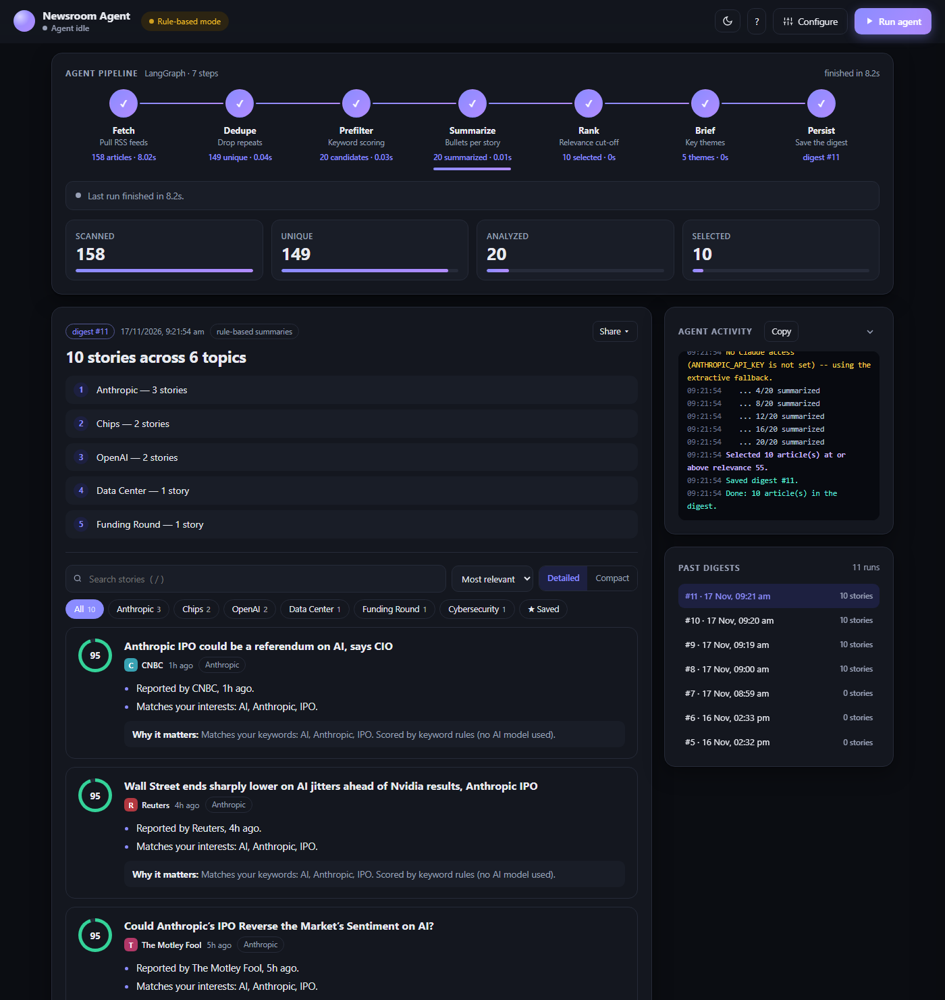

# Daily Industry News Summarizer Agent

An agentic AI pipeline that reads industry news, decides what matters to a specific reader, and writes a concise digest. It is built as a seven-node **LangGraph** workflow, served through a **FastAPI** web dashboard, and stores its memory in **SQLite**. Using **Claude** for the summaries is optional: without an API key, a built-in rule-based summarizer runs the whole pipeline for free.



## What it does

1. **Fetch** articles from RSS feeds and a Google News search built from your keywords.
2. **Dedupe** anything already shown (45-day memory) and near-duplicate headlines.
3. **Prefilter** with whole-word keyword scoring and exclusions, before spending any summarizing effort.
4. **Summarize** each candidate with bullets, a topic, a relevance score (0-100) and a "why it matters" line.
5. **Rank** by relevance and cut to your maximum story count.
6. **Brief** the day's themes.
7. **Persist** the digest and remember what was seen.

A conditional edge skips summarizing entirely on a day with nothing relevant.

## Features

- Live dashboard: animated pipeline, status line, funnel counters, score rings, search, topic filters, compact view, keyboard shortcuts, light and dark theme.
- Editable audience profile, keywords, exclusions, sliders and feed list, saved to SQLite.
- Optional Claude summaries with structured JSON output and graceful fallbacks if a parameter is rejected.
- Optional delivery to Slack (webhook) or email (SMTP), and an optional daily schedule.
- Works offline for everything except fetching news.

## Quick start

```bash
pip install -r requirements.txt
python agenticai.py              # dashboard at http://127.0.0.1:8000
```

Other commands:

```bash
python agenticai.py --once       # run one digest headless and print Markdown
python agenticai.py --port 8080  # choose a port
python agenticai.py --no-browser # do not open a browser tab
```

Press **Run agent** (or `R`) on the dashboard. No API key is needed.

## Optional configuration

Set these environment variables before starting:

| Variable | Purpose |
|---|---|
| `ANTHROPIC_API_KEY` | Enables Claude-written summaries |
| `NEWS_AGENT_MODEL` | Model name (default `claude-opus-5-5`) |
| `NEWS_AGENT_PORT` | Dashboard port (default 8000); `PORT` overrides it, as hosting platforms set it |
| `NEWS_AGENT_HOST` | Address to listen on (default `127.0.0.1`; `0.0.0.0` when deploying) |
| `NEWS_AGENT_DB` | Path of the SQLite file (default: next to the script) |
| `APP_PASSWORD` | If set, every page and API call asks for this password (any username) |
| `DAILY_RUN_AT` | e.g. `07:30` to run once a day |
| `SLACK_WEBHOOK_URL` | Enables Send to Slack |
| `SMTP_HOST`, `SMTP_PORT`, `SMTP_USER`, `SMTP_PASS`, `EMAIL_FROM`, `EMAIL_TO` | Enable email delivery |

Never commit API keys or passwords. The `.gitignore` already excludes `.env` and the local database.

## Deploy it

The app is one process with a SQLite file, so deploying is simple. **Always set `APP_PASSWORD` on a public deployment**, otherwise anyone with the link can change your settings and trigger runs (and spend your API credit if a key is set). `/healthz` stays open for health checks.

**Render (free, from this repo)**

1. On [render.com](https://render.com), choose **New > Blueprint** and select this repository. `render.yaml` and the `Dockerfile` do the rest.
2. When asked, enter `APP_PASSWORD` (required in practice). `ANTHROPIC_API_KEY` is optional; leave it empty for the free rule-based summaries.
3. Open the URL Render gives you, sign in with any username and your password, and press **Run agent**.

On the free plan the service sleeps when idle (the first request takes a short while to wake it) and its SQLite file is reset when it restarts, so history and the "already seen" memory do not persist. Add a persistent disk mounted at `/data` on a paid plan if you need them to.

**Any Docker host**

```bash
docker build -t news-agent .
docker run -p 8000:8000 -e APP_PASSWORD=choose-a-password -v news-agent-data:/data news-agent
```

**Plain Python on a server**

```bash
NEWS_AGENT_HOST=0.0.0.0 APP_PASSWORD=choose-a-password python agenticai.py --no-browser
```

## Project layout

```
agenticai.py            the whole application (pipeline, API, dashboard)
Dockerfile              container image for deployment
render.yaml             one-file Render blueprint
requirements.txt        Python dependencies
docs/
  Project_Report.docx   full project report with code walkthrough and results
  agenticai_code.md     the complete source as Markdown
  dashboard.png         screenshot
```

## Tech stack

Python 3.13, LangGraph, FastAPI, uvicorn, feedparser, SQLite, and (optionally) the Anthropic SDK. The dashboard is plain HTML, CSS and JavaScript embedded in `agenticai.py`, with no build step.
